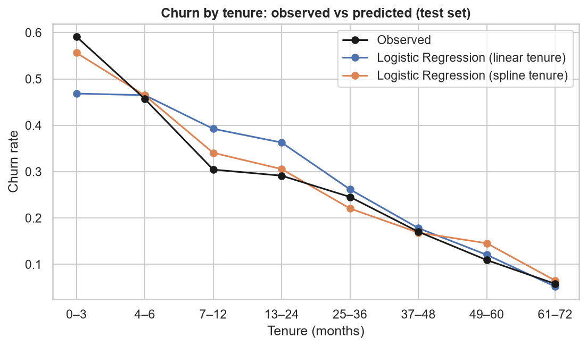
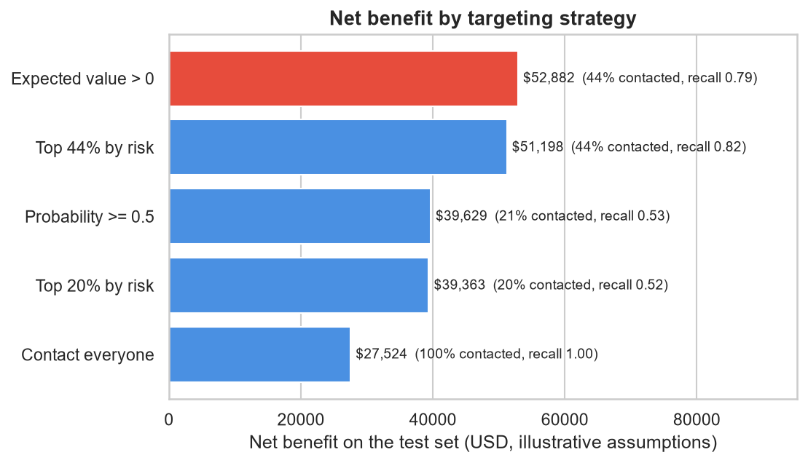
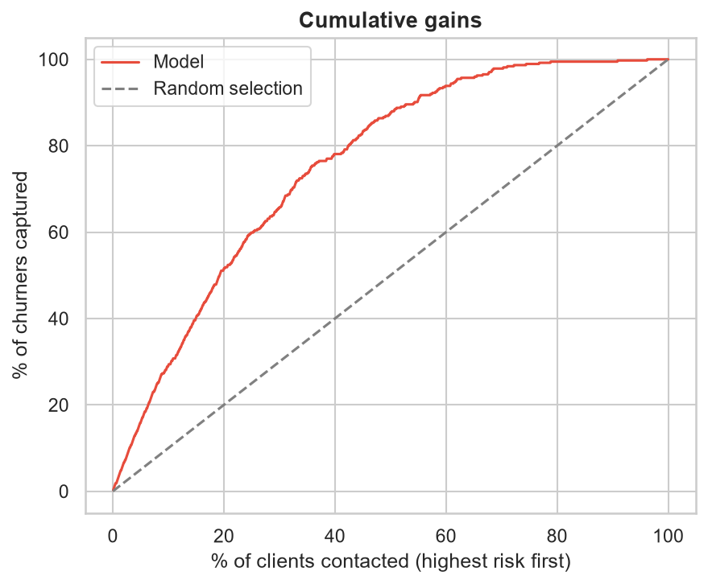
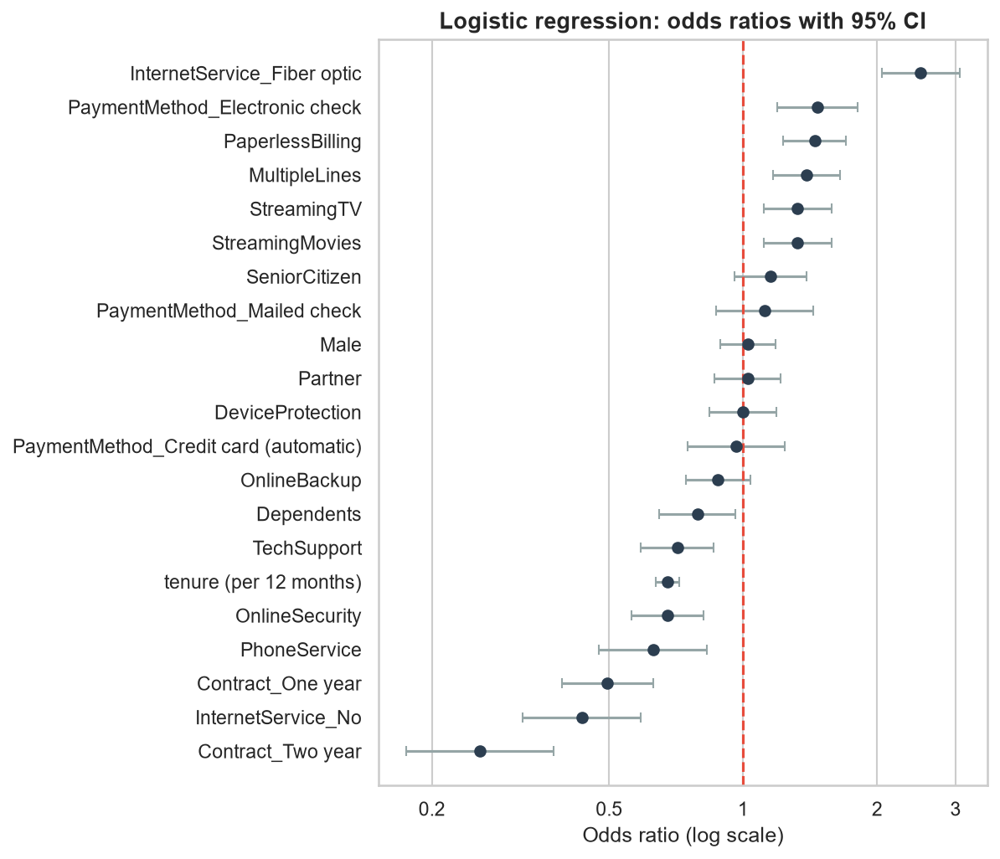

# Customer Churn Prediction (Telco)

End-to-end analysis of customer churn for a telecommunications company. The project starts with a hypothesis-driven exploratory analysis, builds an interpretable model whose probabilities track observed churn rates, and turns its probabilities into a retention decision rule with a cost-benefit evaluation.

## Summary

* **Model:** a logistic regression reaches a ROC-AUC of 0.85 and PR-AUC of 0.67 on the test set (random: 0.27). The calibration check shows predicted probabilities consistent with observed churn rates (calibration intercept −0.04, slope 0.97), and the Brier score is 0.135 (0.195 for a base-rate baseline).
* **Decision:** contacting every client whose expected value of an offer is positive means contacting 44% of the clients and reaches 79% of the churners. If the retention team can only contact the 20% of clients with the highest risk, it reaches about 52% of the churners (2.6 times better than a random selection).
* **Drivers:** contract type, tenure, fiber optic service and, to a lesser extent, electronic check payment. The higher churn of senior citizens and the effect of having a partner show no statistically significant independent effect once other variables are controlled.

## Business problem

Retaining an existing customer is usually cheaper than acquiring a new one. The goal is to understand why customers leave and to build a model that ranks clients by churn risk, so a retention team can focus its offers on the clients most likely to leave.

## Dataset

* Source: [Telco Customer Churn (IBM sample dataset, on Kaggle)](https://www.kaggle.com/datasets/blastchar/telco-customer-churn)
* 7,043 customers and 21 variables: demographics, contracted services, contract and billing information, and the target `Churn`.
* 26.5% of the customers churned (imbalanced target).

## Approach

1. **Data inspection and cleaning:** type checks, duplicates and missing values. The blank values of `TotalCharges` correspond to customers with zero months of tenure, and this was verified with assertions before imputing them.
2. **Exploratory analysis:** hypotheses were written before looking at the data and then contrasted. Several turned out to be wrong, and the interactions between variables were investigated (for example, senior citizens and contract type).
3. **Data preparation:** `TotalCharges` is dropped from all models (it is redundant with `tenure × MonthlyCharges`, VIF 9.5), categorical variables are encoded with explicit reference categories, and the data is split with stratification. `MonthlyCharges` is later excluded only from the logistic regression because it is almost a linear combination of the service indicators (VIF 860), and the AUC does not change, the tree-based models keep it.
4. **Modeling:** Logistic Regression (with a spline on tenure), Random Forest and HistGradientBoosting, compared with 5-fold stratified cross-validation using ROC-AUC, PR-AUC and Brier score. No class weights are used, so the probabilities are not distorted by reweighting. Scaling is done inside a pipeline to avoid data leakage. Odds ratios from `statsmodels` are used to interpret the effects, controlling for the other variables.
5. **Evaluation and decisions:** calibration check, a decision rule based on the expected value of contacting each client, a comparison of targeting strategies on the test set, cumulative gains and permutation importance.

## Results

### Model comparison

| Model | CV ROC-AUC | Test ROC-AUC | Test PR-AUC | Test Brier |
|---|---|---|---|---|
| Logistic Regression (linear tenure) | 0.845 ± 0.012 | 0.839 | 0.630 | 0.139 |
| Logistic Regression (spline tenure) | 0.849 ± 0.012 | 0.848 | 0.665 | 0.135 |
| Random Forest | 0.845 ± 0.010 | 0.843 | 0.650 | 0.136 |
| HistGradientBoosting | 0.849 ± 0.011 | 0.844 | 0.664 | 0.136 |

On the test set the logistic regression with spline `tenure`, Random Forest and HistGradientBoosting are very close (ROC-AUC 0.843–0.848, PR-AUC 0.650–0.665, Brier 0.135–0.136). The logistic regression with linear `tenure` is slightly behind (PR-AUC 0.630), which the spline removes. We keep the logistic regression with spline `tenure`: it matches the tree-based models and stays simple.



### From probabilities to decisions

Each client is contacted only if the expected value of the offer is positive: `probability of churn × success rate × client value − offer cost`. The cutoff adapts to the client, so it does not use a single probability threshold. The assumptions are illustrative (30% success rate, 50 USD per offer, client value of 12 months of revenue), since the dataset has no cost information.

| Strategy | Contacted | Recall | Precision | Net benefit (USD) |
|---|---|---|---|---|
| Contact everyone | 100% | 1.00 | 0.27 | \$27,524 |
| Probability ≥ 0.5 | 21% | 0.53 | 0.66 | \$39,629 |
| Top 20% by risk | 20% | 0.52 | 0.68 | \$39,363 |
| Top 44% by risk | 44% | 0.82 | 0.49 | \$51,198 |
| **Expected value > 0** | **44%** | **0.79** | **0.48** | **\$52,882** |

The expected value rule catches 295 of the 374 churners (79%) by contacting 44% of the clients (620), with 48% precision (325 contacted clients would have stayed). Ranking by probability and contacting the same 44% gives a net benefit 1,697 USD lower (95% bootstrap interval −434 to 4,080), so in this test set the difference is small and its interval includes zero. Most of the gain over the fixed rules comes from choosing how many clients to contact. Across 30 random splits the expected value rule beats it in 29, by about 2k USD on average.



If the team has a fixed capacity, the cumulative gains show how many churners are reached by contacting the highest-risk clients first:



## What drives churn

The table compares the hypotheses written before the analysis with what the exploratory analysis showed and with what remains once the other variables are controlled (odds ratios from the logistic regression).

| Variable | Expected | Exploratory analysis | Controlled model | Verdict |
|---|---|---|---|---|
| `gender` | No effect | 26.9% vs 26.2% | OR 1.02 (p = 0.75) | Confirmed |
| `Partner` | No effect | 19.7% with vs 33.0% without | OR 1.02 (p = 0.79) | Apparent effect in the EDA (13 pp), but no statistically significant independent effect once controlled |
| `PaperlessBilling` | No effect | 33.6% vs 16.3% | OR 1.45 (95% CI 1.23 to 1.70) | Refuted, the effect persists |
| `SeniorCitizen` | Lower churn | 41.7% vs 23.6% (higher, not lower) | OR 1.15 (p = 0.13) | Refuted (higher, not lower). The gap goes with differences in contract and internet profile and is not statistically significant in the multivariate model |
| `Dependents` | Lower churn | 15.5% vs 31.3% | OR 0.79 (p = 0.02) | Confirmed, smaller effect |
| `tenure` | Longer tenure, lower churn | r = -0.35 | OR 0.968 per month (about 0.68 per 12 months) | Confirmed, the effect is non-linear (strongest in the first months) |
| `Contract` | Month-to-month churns more | 42.7% / 11.3% / 2.8% | OR 0.50 (one year), 0.26 (two year) | Confirmed, the strongest factor |
| `PaymentMethod` | Automatic lower, manual higher | Electronic check 45.3%, other methods 15% to 19% | Electronic check OR 1.47, mailed check not significant | Partly, only electronic check stands out |
| Add-on services | More add-ons, lower churn | 52.2% with none to 5.3% with all six | `TechSupport` 0.71 and `OnlineSecurity` 0.68, streaming about 1.33 | Partly, holds only for support and security |
| `InternetService` (not hypothesized) | None | Fiber optic 41.9% vs DSL 19.0% | Fiber optic OR 2.50 (95% CI 2.0 to 3.1) | Unexpected, the largest effect after contract |
| `PhoneService` (not hypothesized) | None | 24.9% vs 26.7% overall, within DSL 24.9% vs 16.6% | OR 0.63 (95% CI 0.48 to 0.83) | Unexpected, only exists within DSL, do not interpret alone |
| `MultipleLines` (not hypothesized) | None | 28.6% vs 25.0% | OR 1.39 (95% CI 1.17 to 1.65) | Unexpected, direction reverses vs. within-type rates |



Other findings:

* Churn is concentrated in the first months. Clients with 0 to 6 months of tenure and monthly charges above 85 USD churned at 78% (190 clients).
* Permutation importance on the test set agrees with the odds ratios: `tenure`, `InternetService` and `Contract` (shuffled by group) are the variables the model relies on most.
* Because `MonthlyCharges` was excluded to avoid multicollinearity with the service indicators, the odds ratios for services like Fiber optic (2.50) and Streaming (~1.33) capture both the service experience and its associated price tier.

## Limitations and next steps

* The data is a single snapshot of 7,043 clients: there is no time dimension, so the model has not been validated on a later period, which is how it would be used in production.
* The data is a sample provided by IBM. A 26.5% churn rate might be unrealistic.
* The model's probabilities are calibrated to this sample's 26.5% base rate. With a lower real churn rate the intercept must be recalibrated: in a simulation, the expected value rule contacts 27% of clients at 10% churn and 4% at 2%, versus 44% here.
* With these assumptions contacting every client is already profitable (about +11 USD per client), which shows the assumptions are generous.
* The results show associations, not causes. For example, fiber optic churn could reflect price, service quality or competition, and the data cannot tell which.
* The cost-benefit analysis uses illustrative assumptions (success rate, offer cost), and the share of clients to contact is sensitive to them (the notebook includes a sensitivity table). Client value is revenue, not margin. The calibration was checked on this snapshot, not on a later period.
* The model predicts who is likely to churn, not who would respond to an offer. Targeting should ideally rely on uplift (the incremental effect of the offer), which requires a controlled experiment.
* The target is whether the client already left (`Churn` = left within the last month), so the model ranks clients retrospectively and no prediction horizon is defined. The 12-month client value assumes the client would have stayed that long.
* Next steps: test interactions (for example tenure × contract), explore SHAP values, and run a controlled test of retention offers to measure their real effect.

## Repository structure

```
.
├── Telco_Customer_Churn.ipynb   # full analysis (EDA, preparation, modeling, conclusions)
├── images/                      # figures used in this README
├── requirements.txt
├── .gitignore
└── README.md
```

The dataset is not included. Download `WA_Fn-UseC_-Telco-Customer-Churn.csv` from Kaggle and place it in the same folder as the notebook (it is ignored by git).

## How to run

1. Clone the repository and download the dataset from Kaggle (see above).
2. Create an environment and install the dependencies:

```bash
python -m venv .venv
# Windows: .venv\Scripts\activate    |    macOS/Linux: source .venv/bin/activate
pip install -r requirements.txt
```

3. Open the notebook with Jupyter and run all cells:

```bash
jupyter notebook Telco_Customer_Churn.ipynb
```

Developed and tested with Python 3.14. Library versions are in `requirements.txt`. A fixed `random_state` is used, so the results are reproducible.

## Tech stack

Python, pandas, NumPy, scikit-learn, statsmodels, matplotlib, seaborn, Jupyter.

## Author

Javier Opazo - [LinkedIn](https://www.linkedin.com/in/javier-opazo) - [GitHub](https://github.com/OpazoJ)
